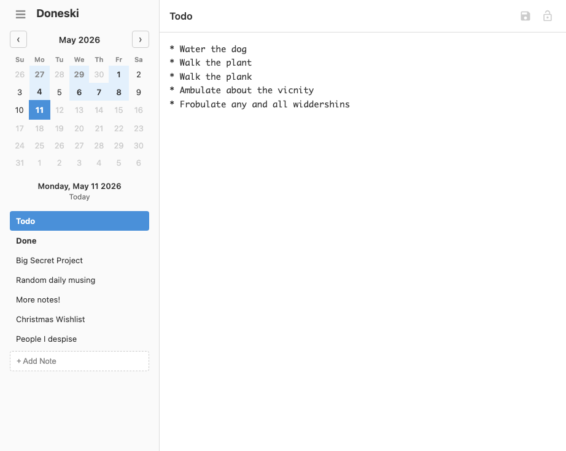
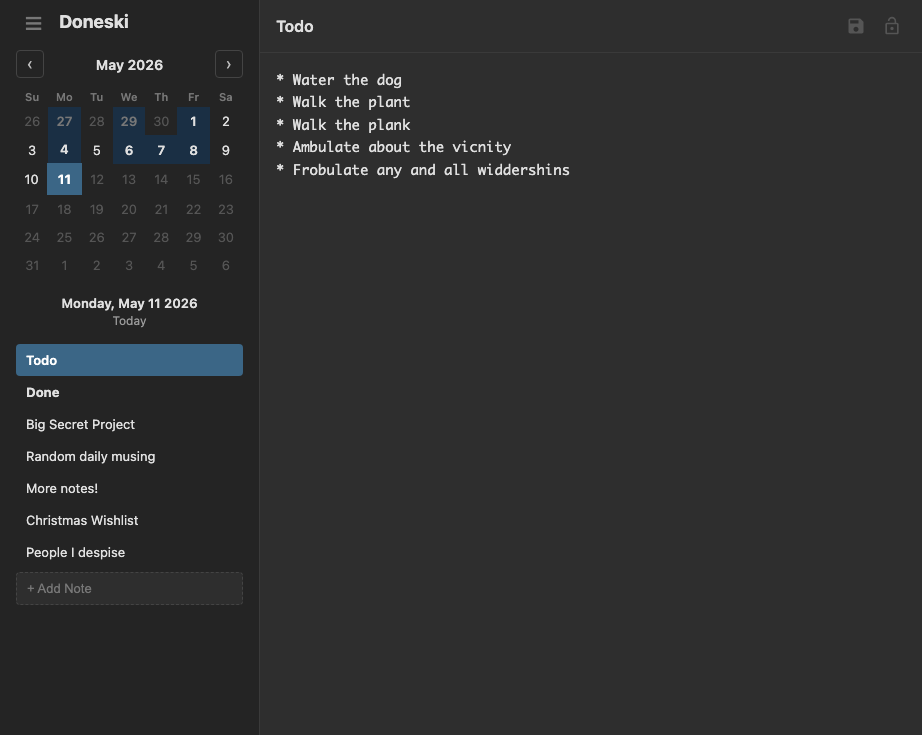

# Doneski

Doneski is a personal daily task and notes management web application designed for anyone who needs to track work items and meeting notes from day to day. Each day carries over the previous day's notes (except completed items), allowing you to maintain a running view of your tasks while keeping a clean daily record of what got done. It features a calendar-based navigation sidebar, per-note editing with auto-save, note locking to prevent accidental edits to past days, and a weekly report generator that compiles your completed items for easy sharing.

See `docs/architecture.md` for detailed information on how the app was designed and built.




# Running

Requires [uv](https://github.com/astral-sh/uv) and Python 3.13+.

```bash
uv sync
uv run doneski
```

The app will be available at `http://127.0.0.1:5000`. Note files are stored in Flask's instance folder (`instance/` relative to the project root by default). Override the location by setting `DONESKI_DATA`. Optionally set `DONESKI_HOST`, `DONESKI_PORT`, or `DONESKI_DEBUG`.

# Running in Docker

The included `Dockerfile` runs the app under gunicorn.

```bash
docker build -t doneski .
docker run -d --name doneski -p 5000:5000 -v doneski-data:/data doneski
```

Notes are stored in `/data` inside the container. The example above uses a named volume, which Docker creates with the right ownership automatically. If you would rather bind-mount a host directory, **it must be owned by uid 5000**, which is the unprivileged user the app runs as:

```bash
mkdir -p /path/to/data && sudo chown 5000:5000 /path/to/data
docker run -d --name doneski -p 5000:5000 -v /path/to/data:/data doneski
```

Configuration comes from the environment (`docker run -e ...`); a `.env` file has no effect under gunicorn. Gunicorn options can be overridden via `GUNICORN_CMD_ARGS`, but see `docs/architecture.md` before increasing the worker count above 1.

The container exposes a health check at `/healthz`, which also verifies the data directory is writable:

```bash
docker inspect --format '{{.State.Health.Status}}' doneski
```

# Development

Run:

```bash
uv sync --group dev
```

Create a `.env` file containing the following:

```bash
DONESKI_DEBUG=true
WERKZEUG_DEBUG_PIN=off
DONESKI_DATA=/path/to/data
```

Then run the development server:

```bash
uv run doneski
```


Run tests with:

```bash
uv run pytest
```
